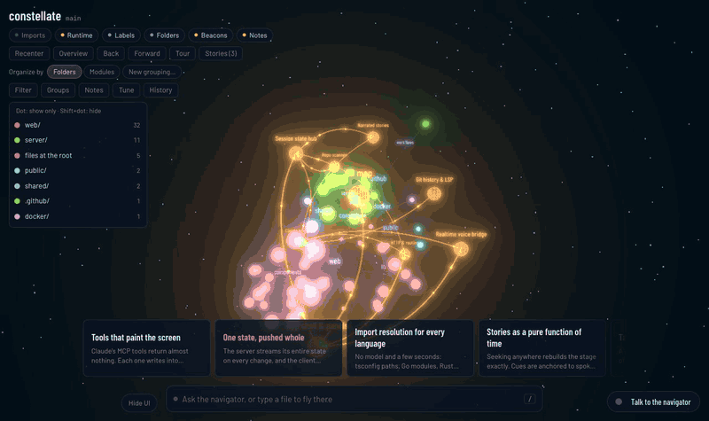

# Constellate

Fly through a codebase as a 3D map. Files are bodies, imports are routes between them,
and a navigator (Claude, through the Agent SDK) reads the code, charts its modules, and
answers your questions on the map, out loud if you like.



## Install

```bash
npm install
npm run dev -- ~/code/some-repo     # http://localhost:4317
```

The navigator uses your Claude Code login, or `ANTHROPIC_API_KEY` if it's set. Voice is
optional: put `INWORLD_API_KEY` in `.env` (see `.env.example`).

For a build that doesn't watch: `npm run build && npm start -- ~/code/some-repo`.

### Docker

One container maps one repository, kept under `/data`:

```bash
docker run -p 4317:4317 -v constellate:/data \
  -e REPO_URL=https://github.com/you/repo.git -e GIT_TOKEN=… \
  -e CLAUDE_CODE_OAUTH_TOKEN=… \
  ghcr.io/rokn/constellate
```

Or one container for any GitHub repo: set `CODEFLIGHT_REPOS_DIR=/data/repos` instead of `REPO_URL`. You give it a link or `owner/name` (on the start page, or "Switch repo" by the repo's name), and it clones it there and opens it. Repos you opened before stay cloned, and going back to one brings back its map, groupings, notes, answers and stories as you left them. After a restart it reopens the last one. `GIT_TOKEN` decides which private repos it can read.

It has no login of its own, so put it behind an authenticating proxy before exposing it.

## In a headset

With a Meta Quest 3 (its browser), or a PC with Link or SteamVR connected, **VR** and
**Passthrough** buttons appear next to the voice button. Nothing else changes when there's
no headset. Go in and out freely: the open file, the focus, answers and stories carry
across both ways. In passthrough, Menu → **Place on a surface** puts the map on a table.

WebXR needs a secure page. Over USB, run `adb reverse tcp:4317 tcp:4317` and open
`http://localhost:4317` on the Quest. Over Wi-Fi, put a [mkcert](https://github.com/FiloSottile/mkcert)
certificate for your LAN address in `.certs/codeflight.pem` and `.certs/codeflight-key.pem`,
and open `https://<your-LAN-address>:4443`.

| Quest controller | |
| --- | --- |
| Trigger, or pinch | Point and select; held and moved on a body, drag it; on open sky, drag the map |
| Grip | Grab the map; both grips to scale and turn it; on a panel or its handle, carry it |
| Left stick · right stick | Fly where you point · turn ← →, zoom ↑ ↓ (or push and pull a held body) |
| A · B · X · Y | Menu · back · voice · the whole map |

The dock's **?** shows these in the headset. **Tune** there holds every knob the desktop's
Tune panel has (the same settings, so changes carry across), plus the headset's own:
render resolution and bloom, how much of the room shows through in passthrough, a floor
grid in VR, turning and speeds, and the voice volume. Panels stay where you carry them;
Menu → **Recenter panels** brings them back in front of you.

History, branch view and custom views stay on the desktop for now.

## Shortcuts

| Key | |
| --- | --- |
| `/` or `⌘K` | Ask the navigator, or jump to a file, symbol or module |
| `Space` | Frame the selection: the file, then the file with its connections |
| `Esc` | Close the top thing, and last of all undo "show only" (modules you hid stay hidden) |
| `o` | Overview |
| `[` `]` | Back and forward through what you've opened |
| `f` / `m` | Filter / markers on the map |
| `h` | History: the map at each commit, `↑` `↓` to step |
| `a` | Answers so far |
| `n` | Note on the open file or hovered import |
| `s` | Stories |
| `t` | Guided tour of the modules |
| `i` / `l` | Imports / runtime layer |
| `x` | Hide the focused files |
| `u` | Hide the UI |
| `v` | Voice on or off |
| `,` | Tune the map |

**Mouse:** left-drag orbits, hold right-drag to fly, and the wheel zooms toward the
pointer. Click a file to select it and light its connections. In the module list, click
a dot to show only that module, Shift-click it to hide it, and double-click a module to
isolate it and fly to it. Hold Shift over a module to light where it connects.

**Touch:** one finger orbits. Two fingers pinch to zoom toward your fingers, drag to pan, or
twist to spin the sky, whichever they start doing; they keep to it until they lift. Spread
two fingers on a module's beacon to show only that module, and pinch them shut on it to
bring the rest back. Press and hold on a file, a module or open sky for a ring
of actions (open, ask about it, note, show only, hide, the whole map…): slide to one and
lift, or lift in the middle and tap one. Double-tap open sky to see the whole map. Swipe
with three fingers: sideways for back and forward, down for the whole map, up to hide the
controls. "Tilt to look", in the ring on open sky, turns the view as you turn the tablet,
and laying the tablet flat on a table shows the whole map from above. With History or a
story open, slide your thumb along the bottom edge to scrub through it. On Android you feel
a tick for each commit or beat you scrub past, each module you fly into, and the
navigator's arrivals.
