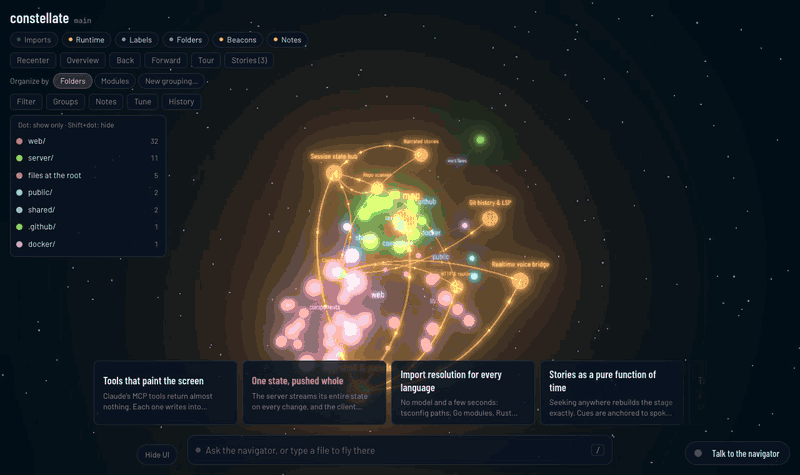

# Constellate

Fly through a codebase as a 3D map. Files are bodies, imports are routes between them,
and a navigator (Claude, through the Agent SDK) reads the code, charts its modules, and
answers your questions on the map, out loud if you like.



## Install

```bash
npm install
npm run dev -- ~/code/some-repo     # http://localhost:4317
```

The navigator uses your Claude Code login, or `ANTHROPIC_API_KEY` if it's set. Voice is
optional: put `INWORLD_API_KEY` in `.env` (see `.env.example`).

For a build that doesn't watch: `npm run build && npm start -- ~/code/some-repo`.

### Docker

One container maps one repository, kept under `/data`:

```bash
docker run -p 4317:4317 -v constellate:/data \
  -e REPO_URL=https://github.com/you/repo.git -e GIT_TOKEN=… \
  -e CLAUDE_CODE_OAUTH_TOKEN=… \
  ghcr.io/rokn/constellate
```

Or one container for any GitHub repo: set `CODEFLIGHT_REPOS_DIR=/data/repos` instead of `REPO_URL`. You give it a link or `owner/name` (on the start page, or "Switch repo" by the repo's name), and it clones it there and opens it. Repos you opened before stay cloned, and going back to one brings back its map, groupings, notes, answers and stories as you left them. After a restart it reopens the last one. `GIT_TOKEN` decides which private repos it can read.

It has no login of its own, so put it behind an authenticating proxy before exposing it.

## Projects

Everything lives in a **project**: its repos, and its boards. The project's bar (top left,
in every view) switches between its two kinds of view:

- **Code**: the 3D map of one of the project's repos at a time (everything below: the
  navigator, agents, traces, history). A project can link any number of repos; pick one in
  the drawer, or link another (a folder on the server, or `owner/name` when it keeps GitHub
  clones). A repo opened with **Switch repo** joins the project you're in.
- **Boards** ([the workshop](#the-workshop)): planning boards in a tree, like folders. The top
  level is for the big subjects (Architecture, Deployments, the roadmap…); under each, the
  boards nested in it, whether it's an item's inside (◈) or a board filed under it (▣). Drag
  one onto another in the drawer to nest it, ⤒ to bring it back to the top.

Click the project's name for the drawer: its repos, its boards (new, nested, renamed,
deleted), and the other projects; `/projects` lists them all and starts new ones. The
address says where you are (`/p/<project>/code`, `/p/<project>/board/<board>`), and the
addresses from before projects (`/`, `/board/<id>`, `/?root=…&module=…`) still work: they
find their project. The first time it runs, everything that was there (every board, the
repos they were drawn from, the open repo) moves into one project.

**Boards and code link up.** A board item that stands for code (blocks drawn from a repo,
or any item you give paths in the inspector) **expands into code**: **Expand into code ⤢**
in its inspector, Shift-E, or "show me the code of this" switches to the Code view with the
map filtered to just that code and named for the item. An item with no link gets **Find its
code ⤢**: the navigator finds it, and shows it. Back the other way, the Code view's focus
bar shows the board items for what's in focus (▣ Payments ↗) and ◂ Board returns to the one
you came from.

**One voice, both views.** The voice stays on as you move between views, and does whatever
the view on screen does: on a board, it builds (Jarvis); in the Code view, it navigates and
asks the navigator. It switches views itself: "show me the code of this" on a board (it
follows the item's code link, or has the navigator find it), "where is this on the
architecture board?" from the code, "open the deployments board", "go back to the board",
"show me the other repo". A tool of the other view (fly to a file while on a board, add a
block while in the code) switches first. Typed, the same: Jarvis on a board has `show_code`,
and the navigator in the Code view has `open_board`.

## Go apps

In a Go repository, **Organize by → Go apps** (on the desktop, in the headset's menu, or
"organize by Go apps" to the voice) turns each executable, every `package main`, into an
app. An app holds the packages only it imports, directly or through others; the packages
two or more apps import are the shared libraries between them, and the lines between
groups show which app imports which library. Packages no executable reaches gather under
"in no app". It's built from the imports alone, so it's there before the navigator has
charted anything, and it's rebuilt with every scan.

With traces coming in (see [Traces](#traces)), the same view says what runs. Each service
is matched to its app by its executable's name (else its own name, else where its spans
ran). Import lines between groups read **ran N×** or **not seen running**. Calls no import
explains get lines of their own: **http**, **rpc** or **messages** between the apps that
sent and served them, whichever library made the call, and **runtime only** for in-process
calls through an interface or a callback. Each app's card names its service, its spans
and errors, and what it calls most, databases and hosts outside the repo included.
Groups no trace reached say so.

## Agents

Constellate can also change the code. Ask for it ("add retries to the uploader") by voice
or in the Ask box, or type a task in **Agents**, and a coding agent (Claude Code, through the Agent SDK) starts
on it in its own git worktree, on a branch of its own (`agent/<name>-<id>`) off the commit
you're looking at. Several can work at once. The files each one touches light up under
a marker as it goes, and when it finishes the voice tells you what it did. **Show on map**
(or "show me what it did") puts its branch on the map against where it started; you can
send it follow-ups, stop it, or discard it with its branch.

What it changed is committed to its branch when it stops. With `GIT_TOKEN` set, the
branch is then pushed and a pull request opened into the branch it started from (a
fine-grained token needs Contents and Pull requests read and write); follow-ups you send
it go to the same PR. **Merge** in the panel (or "merge it" to the voice, which asks
first, or typed in Ask, which puts a Merge button on the answer to press) rebase-merges
the PR on GitHub. A PR merged, closed or retargeted on GitHub shows as such here: the
server checks every two minutes (`CONSTELLATE_PR_SYNC_SECONDS`), when the repo opens and
when the Agents panel does; a closed one can be opened afresh with **Open PR**. Typed or
spoken, questions still go to the navigator; the Ask box and the voice share one set of
agent tools (`server/actions.ts`). Without a token, nothing
leaves the box. When its base has moved on, **Rebase** (or "rebase it") fetches the base
branch and replays the agent's commits on top of it, pushing to its PR if it has one; if
they conflict, the branch is left as it was and you're told which files. In the headset,
the menu's **Agents** tab lists them, starts new ones, rebases them, and merges them
(press Merge twice).

An agent can read and edit files only inside its worktree, and has no
shell unless you turn one on (see `.env.example`). Worktrees live under the cache directory.

## Traces

Constellate takes OpenTelemetry traces in and works out what the code really calls when
it runs. Point an app's exporter at it (`OTEL_EXPORTER_OTLP_ENDPOINT=http://<host>:4318`):
it takes OTLP/HTTP on port 4318, protobuf or JSON, gzipped or not, and on `/v1/traces` of
the main port too. Without a repo open it answers 503, which exporters retry. To pull
from a backend instead, set `CONSTELLATE_TEMPO_URL` or `CONSTELLATE_JAEGER_URL` (see
`.env.example`). A test run's traces can be posted too: a collector's file exporter
output (JSON lines) works as-is.

Each span is pinned to the file it ran in. The server tries its `code.file.path` attribute
first, then its qualified function name (for Go, `pkg/path.(*Type).Method`), then a tracer
named for one of the repo's packages (`otel.Tracer("github.com/you/app/internal/store")`),
and last its name if that's a symbol defined in only one file. Each step from a span to
its child in another file, in another service, or out to a database or a host adds to
a runtime edge. A file-to-file edge gets a verdict: **confirmed** when an import backs it,
**package** when both files are in one Go package, and **runtime-only** when nothing static
explains it.

| | |
| --- | --- |
| `GET /api/runtime` | Services (with the executable and the files each ran), edges, external endpoints, imports never seen used, and the span names that couldn't be pinned. `?service=a,b` and `?path=` narrow it. |
| `GET /api/traces` | Recent traces, kept whole in memory (`?service=`, `?limit=`) |
| `GET /api/traces/<id>` | One trace's spans, each with its location |
| `DELETE /api/runtime` | Forget this repo's traces |

The session stream carries `runtime` (a version, counts, services and the sources'
health) so the page knows when to refetch. Totals are kept per repo, next to its session.

## In a headset

With a Meta Quest 3 (its browser), or a PC with Link or SteamVR connected, **VR** and
**Passthrough** buttons appear next to the voice button. Nothing else changes when there's
no headset. Go in and out freely: the open file, the focus, answers and stories carry
across both ways. In passthrough, Menu → **Place on a surface** puts the map on a table.
The headset anchors it there (and, where it can, keeps the anchor, so the next session
puts the map back on the same table) and finds the table's edges from the room's planes.
A strip of controls then lies along the edge nearest you, and a shelf along the right-hand
edge holds what you've taken off the map: throw a module away, or drop a dragged one on
the shelf, and it waits there, collapsed, until you press it to put it back.

WebXR needs a secure page. Over USB, run `adb reverse tcp:4317 tcp:4317` and open
`http://localhost:4317` on the Quest. Over Wi-Fi, put a [mkcert](https://github.com/FiloSottile/mkcert)
certificate for your LAN address in `.certs/codeflight.pem` and `.certs/codeflight-key.pem`,
and open `https://<your-LAN-address>:4443`.

| Quest controller | |
| --- | --- |
| Trigger, or pinch | Point and select (a module: its files and the links between them; again, with what they talk to); held and moved on a body, drag it (throw it to hide it, or grip before letting go to pin it there); on open sky, drag the map |
| Grip | Grab the map; both grips (or both hands pinching) to scale it and rotate it any way; on a panel or its handle, carry it (the stick pushes and pulls it; the other hand's grip on the code, answers or story panel resizes it) |
| Left stick · right stick | Fly where you point · turn ← → about what you're looking at, zoom ↑ ↓ (or push and pull a held body) |
| Right stick click | On a body, focus on it; again, a ring more of its connections (the bar over the dock widens and narrows it, and **Only these** hides the rest of the map) |
| A · B · X · Y | Menu · back · voice · the whole map |

| Hands | |
| --- | --- |
| Pinch | As the trigger: select; held on a body, drag it (throw it to hide it); on open sky, drag the map; both hands, scale and rotate it |
| Touch with a fingertip | Press any panel's buttons; with a pointing finger, touch a body to pick it |
| Pinch open sky, hold still, draw a loop | Light up the files inside the loop |
| Thumb on middle finger | Right hand: forward · left hand: back |
| Left palm up | A menu on your wrist, to touch with the other hand |
| Both hands in an L, framing | Light up what's in the frame (frame all of it for the whole map) |

A keyboard works in the headset too, in VR and passthrough (a Bluetooth one paired with
the Quest, or the PC's own over Link). **Enter** or **/** opens the room's keyboard to ask,
and while it's open you type into it: **Enter** sends, **Esc** closes. Otherwise the arrows
or **WASD** fly the way you're facing, **Q / E** (or Page Down / Up) sink and rise, and
**Shift** goes faster; other keys are the desktop's shortcuts.

The dock's **?** shows these in the headset, for what you're holding: controllers, hands, or both. **Tune** there holds every knob the desktop's
Tune panel has (the same settings, so changes carry across), plus the headset's own:
render resolution and bloom, how much of the room shows through in passthrough, a floor
grid in VR, turning and speeds, and the voice volume. Panels stay where you carry them;
Menu → **Recenter panels** brings them back in front of you.

History, branch view and custom views stay on the desktop for now.

## Checked connections

Reviewing a codebase, mark import lines **checked** (reviewed, safe) as you go: one line
at a time, or every connection of a file at once. Checked lines turn lime and stop
carrying particles, so what's left to look at stands out. The marks are kept with the
repo, beside your notes, and follow files that git sees renamed.

- **Desktop:** hover a lit import line and press `c`, or Shift-click it. With a file open,
  `c` checks all its connections (again to take the marks off); `Shift+C` checks every line
  lit in the focus. The code panel marks each import and importer with ✓ (click to toggle)
  and has **Check all**, with how many are done.
- **Touch:** press and hold a lit import line for its ring (Mark checked, Open import,
  Note); hold a file for **Check all**. The code panel's ✓ work by tap too.
- **Headset:** the file panel has a ✓ on every connection's row and **Check all** in its
  header (a controller's ray or a fingertip); with a focus made by the stick, the bar over
  the dock has **Check** for every line it lights.
- **Voice and Ask:** "mark this file's connections as checked", "the import from the
  server to the session is safe", "uncheck its inbound ones", "what's left to check here?"
  (`mark_checked`, `checked_status`).

Tune → **Checked connections** turns them off the map (only what's left shows), drops
the tint, or dims them. Filter → **Hide checked files** takes off files whose every
connection is checked, in the headset's filter too. `POST /api/checked` with
`{"action": "check" | "uncheck", "links": [{"from", "to"}]}` or `{"action": "clear"}`
does the same from outside.

## The workshop

A project's **Boards** (see [Projects](#projects)): 3D planning boards on a round holotable,
for designing anything — a system's architecture, a deployment, a roadmap, a device. A board
can stand on its own, or be drawn from one of the project's repos and stay linked to its code.

- **Components**: architecture blocks (service, database, queue, API, client, user,
  cache, storage, lambda, external, cloud), notes, floating text, frames that group
  things on the table (and carry them when moved), ink you draw, and **holograms** —
  any 3D object, built from parts (or a script, run in a sandbox in the browser),
  that pull apart. A **library** of ten ready-made ones, and **templates** for whole
  boards (microservices, event pipeline, three-tier, roadmap, SWOT, kanban).
- **Jarvis** (Claude, through the Agent SDK, with only board tools) builds on it: type
  after `/`, or say it. "Design a payments platform", "build a hologram of a jet engine",
  "review this", "walk me through checkout", "estimate the load", "design the inside of
  the order service". It can **simulate** a request hop by hop and **present** the board
  as a tour (captions on every screen), **flag** review findings as beacons, put
  **metrics** on items as gauges, pin notes to what they're about, and open a block's
  **inside** board. All of one request is one undo, with a version kept before it.
- **The voice** (Inworld, as on the map) does the quick things itself — add, link, move,
  recolour, select, pull apart, place a library hologram or a template, go inside and
  back up, save or go back to a version, layers, every Tune knob — and hands anything
  that needs designing to Jarvis, then says what it built.
- **Live**: the server owns each board (`.cache/boards/`); every screen on it sees every
  change as it happens, and the others' cameras, heads and hands as ghosts.
- **History** (`H`): versions kept as you work and before every request; preview one on
  the table, restore it. **Export**: a Markdown design doc, Mermaid, JSON, PNG.
  **Import**: Mermaid or JSON, or just paste either onto the board (`⌘V`).
- **Find** (`⌘F`), **Layers** (`L`: hide kinds, isolate the selection), box select
  (shift-drag on the table), copy and paste across boards, a link inspector (click a
  link), and a progress ring on the table's rim.
- **Tune** (`,`): every knob — glow, holograms, labels, links, the table, the camera,
  editing, and the headset's placement, panels, hands, sound and voice — with built-in
  looks (Stark, Neon, Calm, Readable, Blueprint, Quest performance) and your own presets,
  kept on the server. The voice and Jarvis can turn any of them.

- **Bring things in**: **Repo → board** (Jarvis reads the repo open in the code map — its
  charted modules, the import graph, compose files, manifests, Dockerfiles — and builds the
  real architecture; the board then stays linked to that repo, so later questions — "where do
  refunds happen?" — and redesigns read the actual code, by voice too), **Photo → board** (a whiteboard photo: a file, pasted into the ask bar,
  dropped on the table, or the Quest's camera), **Sketch → structure** (your ink, read from
  above and rebuilt as blocks, links, notes and frames where you drew them).
- **Links that talk their protocol**: REST packets out with replies back, gRPC streams both
  ways, Kafka a dense stream, a queue bunching and draining, WebSocket waves, SQL in heavy
  chunks — set on the link or guessed from its label — and a sample message riding along.
- **Levels** (C4): going inside an item morphs its board out of it, and coming back shrinks
  it back in; the breadcrumbs say which level (context, containers, components, code).
  **Depth tiers** (`T`): frames float as stacked layers with what's in them.
- **Views** (`K`): snapshot cards of where you were looking, with a picture, for every
  screen; click one to fly back. **Lasso** (`S`) and **eraser** (`X`): drag across items to
  select or delete them all. Items snap magnetically to their neighbours, with guides.
- **Voice macros** ("when I say *ship it*, review the design, save a version and export"),
  **dictation** (your next words, exactly, as a name or a note), switching boards and any
  action by voice. Switching boards keeps you in the headset, and so does switching views: the
  wheel's **Expand into code** (or the voice: "show me the code of this") takes the session over to
  the Code view, and its menu's **◆ Boards** brings it back, in VR or passthrough.
- **Lock items** keeps the board's layout: rays and grips on open air move the board itself, but
  an item grabbed right at the hand can still be carried, stretched open or thrown at a wall, and
  springs back to where it was when you let go.

In a headset it's at its best in **Passthrough**: the table sits on your desk.

- **Buttons**: A, B, X, Y each do one thing tapped and another held, and so do the stick
  presses — by default A the palette / held the **board shelf**, B undo / redo, X voice /
  **dictate**, Y tune / **snapshot**, the left stick press shows or hides the left-hand menu (its table button resets the table). Hold the right
  stick in for the **command wheel**: tilt to a slice, let go. Look at a controller to see
  what its buttons do; a chip says what each press did. Every one of them is a Tune knob
  (Headset · Controller buttons, Headset · Wheel and palm menu).
- **Guide**: the dock's **?** opens a tour you play through — controllers, hands, two hands and
  nested boards, the room, the keyboard — each step drawn (the controller with its button lit,
  the hand in the pose) and waiting for you to do it. Its **Map** tab lists every button, wheel
  slice, gesture and key as they're set now (F1 on a keyboard). It opens by itself the first
  time you enter (Tune: Guide when you enter).
- **The voice doesn't cut itself off**: it plays through a WebRTC loopback so the browser's
  echo canceller hears it (a Quest's speakers sit right by its mic), the mic sends silence
  while it speaks unless you're clearly louder than its echo, and talking over it ducks it
  first — it stops only if you keep talking or words come through, so a cough doesn't. Tune →
  Voice has each of these, and a playback buffer for patchy Wi-Fi. (The code map's voice gets
  the same.)
- **Transcript log**: everything said, yours and its, with what happened along the way (talked
  over, a sound it ignored, reconnecting). Desktop: the **Log** chip (R; in the code map, the
  Log button by the voice, shift-V) — drag it anywhere, pin it to keep it open there. Headset:
  the dock's speech bubble (Alt-R) — pin it, carry it, or throw it at a wall.
- **Boards ↔ the Code view**: blocks drawn from a repo carry a code link (the code map's module
  and their main paths — editable in the inspector). **Expand into code ⤢** (Shift-E, the
  "Expand into code" action, or "show me the code of this") switches to the Code view filtered to
  that code, opening the board's repo first if another is open; the toolbar's ⌥ chip opens the
  repo. Back the other way, the Code view's focus bar shows the board items that point at what's
  in focus (▣ Payments ↗), and ◂ Board returns where you came from. Boards inside a linked block
  are linked too; a board with no repo of its own reads its project's.
- **What has a board inside** shows at a glance: amber layers float over it, a dashed amber
  ring circles it on the table, and its name reads "▣ inside · 5 items" (Tune → Labels).
- **Lock the items**: the dock's padlock (or Shift-L / the Lock chip on the desktop) freezes
  everything on the board — every grab, pinch and drag moves the board itself, and the mouse
  only turns the view. Jarvis and the voice can still change things.
- **A keyboard**: pair a Bluetooth keyboard with the Quest and just type — a text bar opens in
  front of you; Enter sends it to Jarvis, or (Tab) makes it the selected item's label or a new
  note. Alt + a letter runs a shortcut (Alt-I inside, Alt-U up, Alt-1…8 the wheel's slices; or
  letters alone, in Tune), Space talks, Del deletes, Ctrl-Z undoes. Your hands rest while you
  type: hand pinches, pokes and menus pause, and come back a moment after the last key.
- **Hands**: turn your right palm up and the wheel blooms from it; turn your left palm toward
  you for the **wrist dock** (its eye turns passthrough off and on without leaving; the red
  door leaves the headset). Poke any panel with a fingertip. Middle-finger pinches: voice
  (left) and undo (right). **Record your own gestures** (a thumbs-up, a fist, a peace sign)
  and bind each to any action.
- **Items**: point and pinch (or trigger) to select and drag along the ray — the stick pushes,
  pulls and turns it; hold still on one to talk about it. Grab one (grip, or a pinch right on
  it) to carry it: throw it away to delete it, **close your fist** (or pull the trigger while
  gripping) to **crumple** it. Both hands on one: **scale** it, **pull a hologram apart**, or
  **spread wide to dive inside** — the other hand's trigger or middle pinch swaps which.
  With the connect tool, **draw a link through the air** and it keeps your curve.
- **The table**: grab empty air to move it, both hands to turn and scale it — past twice its
  size over an item you dive inside, under half you come back out. **Desk mode** fits it onto
  your real desk (from Space Setup) with shadows on the desk; **wall mode** stands it on a
  wall; **room scale** blows it up so you walk inside it. It stays anchored where you left it.
- **Boards around you**: the **shelf** shows every board as a small live hologram; pinch one
  to switch, carry one to the table, into the room (it stands there, live) or throw it at a
  wall. Walk up to a board standing in the room to use it, and link items across boards.
  Throw a panel at a wall and it sticks there.
- **History**: twist your wrist like a dial to **scrub through undo history**, the board
  showing each step; pinch to go there.
- **Sound**: effects come from where they happen — pitched by size — and the board hums,
  louder as you lean in.

Press `?` on the desktop for every shortcut.

## Shortcuts

| Key | |
| --- | --- |
| `/` or `⌘K` | Ask about the code or for a change, or jump to a file, symbol or module |
| `Space` | Frame the selection: the file, then the file with its connections |
| `Esc` | Close the top thing, and last of all undo "show only" (modules you hid stay hidden) |
| `o` | Overview |
| `[` `]` | Back and forward through what you've opened |
| `f` / `m` | Filter / markers on the map |
| `h` | History: the map at each commit, `↑` `↓` to step |
| `a` | Answers so far |
| `n` | Note on the open file or hovered import |
| `c` | Mark the hovered import line checked, else all of the open file's connections; `Shift+C`: every line in the focus |
| `s` | Stories |
| `t` | Guided tour of the modules |
| `i` / `l` | Imports / runtime layer |
| `x` | Hide the focused files |
| `u` | Hide the UI |
| `v` | Voice on or off |
| `,` | Tune the map |

**Mouse:** left-drag orbits, hold right-drag to fly, and the wheel zooms toward the
pointer. Click a file to select it and light its connections. In the module list, click
a dot to show only that module, Shift-click it to hide it, and double-click a module to
isolate it and fly to it. Hold Shift over a module to light where it connects.

**Touch:** one finger orbits. Two fingers pinch to zoom toward your fingers, drag to pan, or
twist to spin the sky, whichever they start doing; they keep to it until they lift. Spread
two fingers on a module's beacon to show only that module, and pinch them shut on it to
bring the rest back. Press and hold on a file, a module or open sky for a ring
of actions (open, ask about it, note, show only, hide, the whole map…): slide to one and
lift, or lift in the middle and tap one. Double-tap open sky to see the whole map. Swipe
with three fingers: sideways for back and forward, down for the whole map, up to hide the
controls. "Tilt to look", in the ring on open sky, turns the view as you turn the tablet,
and laying the tablet flat on a table shows the whole map from above. With History or a
story open, slide your thumb along the bottom edge to scrub through it. On Android you feel
a tick for each commit or beat you scrub past, each module you fly into, and the
navigator's arrivals.
